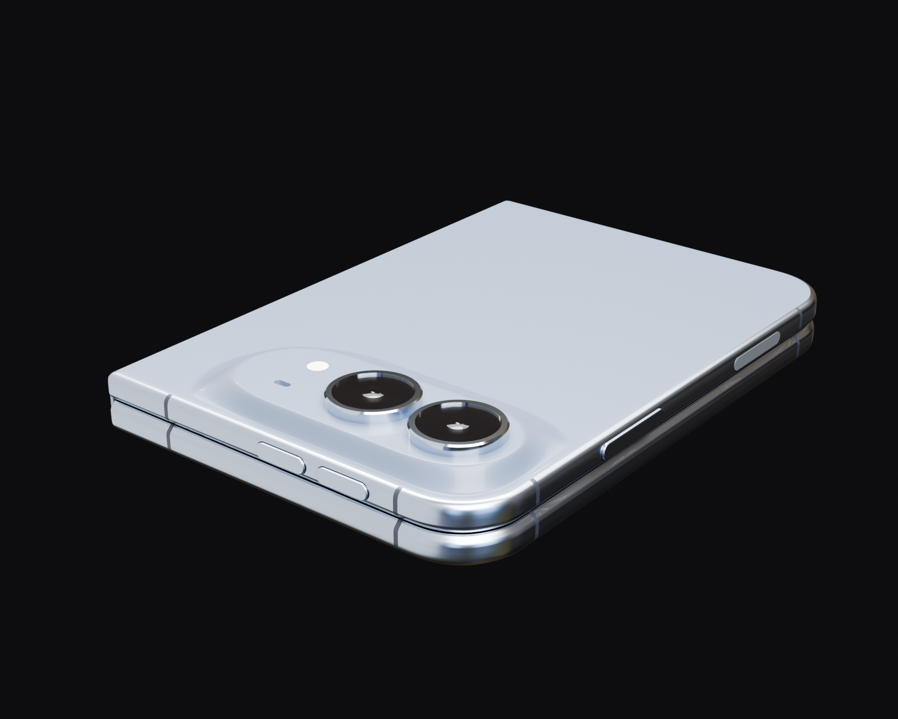
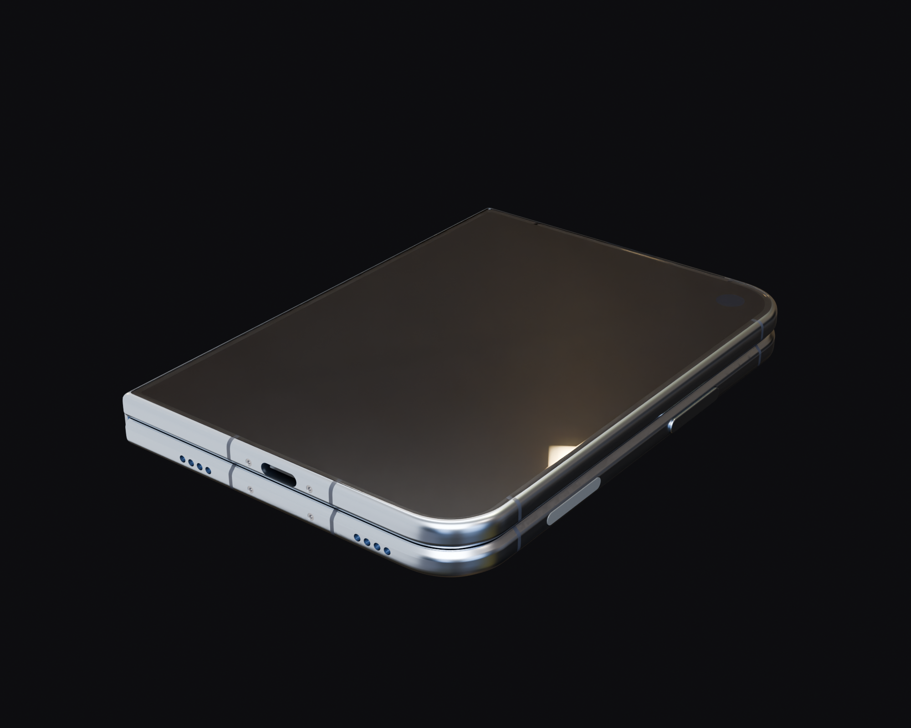
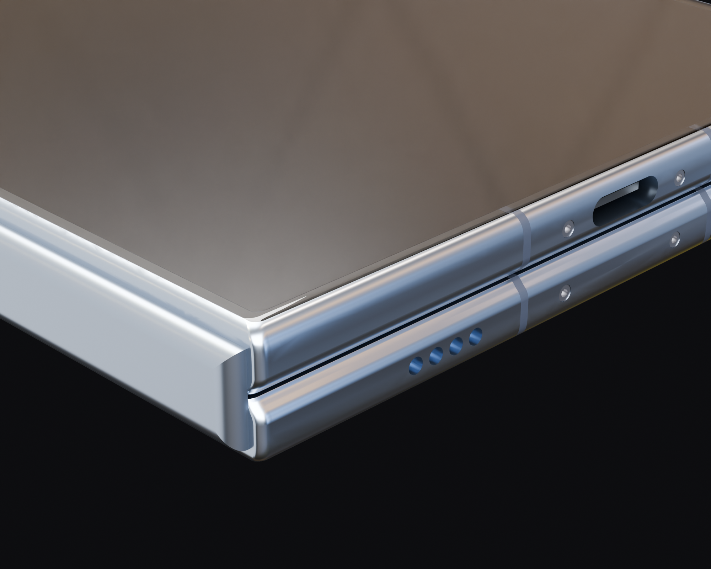

# iPhone Duo CAD (folded)

A STEP model of the folded iPhone Duo, built from Apple's public dimensional drawing
([iphone-duo.pdf](https://developer.apple.com/download/files/accessories/dimensional-drawings/iphone-duo.pdf),
sheet 1 of 7). Every dimension on the sheet was checked against the exported STEP:
67 of 67 land within 0.02 mm. The worst miss is 0.015 mm.

Unofficial. Not affiliated with or endorsed by Apple. iPhone is a trademark of Apple Inc.





## Get it
- **STEP** (19 named, coloured parts) and **GLB**: [latest release](../../releases/latest)
- **Look at it in the browser**: open [`iPhone_Duo.stl`](iPhone_Duo.stl) on GitHub and drag to rotate
- **Every number checked**: [`build/verification.md`](build/verification.md)

## What comes straight from the drawing
Envelope (84.10 x 117.80 x 11.30), Detail A corner (a continuous-curvature curve through all 7 points),
Detail B edge round, Detail E hinge barrel and hinge-side round, Detail AY corners, buttons, ports,
screws, USB-C, cameras, flash, mic, the camera plateau's top (4.94 / 60.56 / -4.70 / -25.80) and base
(69.37 / -34.62), cover glass and display active area.

## What is traced or assumed (sheet 1 doesn't dimension it)
- The rounded seam between the two halves
- The plateau end-cap shape and the slope from its top down to its base
- Lens glass Ø13.7, ring chamfer, USB-C height 2.60, receiver slot width 0.50, glass thickness 0.65
- Antenna line positions and 0.9 mm width
- Volume button width, set equal to the side button (3.06)
- Not modeled: logo, inner display, unfolded state, anything on sheets 2-7

## Where the drawing contradicts itself
- The "all around" callouts don't add up with the glass and active-area sizes (off by 0.05-0.09 mm).
  The model uses the sizes.
- The hinge barrel ends 1.19 from the top in Detail AY and 1.23 in the side view. The model uses 1.19.
- The front view puts the start of the flat face 4.16 from the hinge. Detail E shows 2.74. The model
  follows Detail E.
- The side view is drawn about 7% thinner than its own 11.30 dimension.

## Frame
X runs from the hinge exterior (0) to 84.10. Y runs from the top edge (0) down to -117.80. Z starts at
the fold plane: +Z is the outer-display half (A), -Z the camera half (B). These are the drawing's datums.

## Rebuild
```
python3.12 -m venv .venv && .venv/bin/pip install -r requirements.txt
.venv/bin/python -m duo.build --fresh   # ~1.5 min, writes build/
.venv/bin/python -m duo.verify          # build/verification.md
blender -b -P render/render.py -- rear_iso 256   # Blender 5.2
```
`render/overlay.py` lays the renders over Apple's drawing. It expects sheet 1 of the PDF rasterised
to `ref/drawing_sheet1.png` at 2550 x 1650. The drawing isn't included here; get it from Apple.

## License
Code: MIT (see `LICENSE`). Model files and renders: CC BY 4.0.
